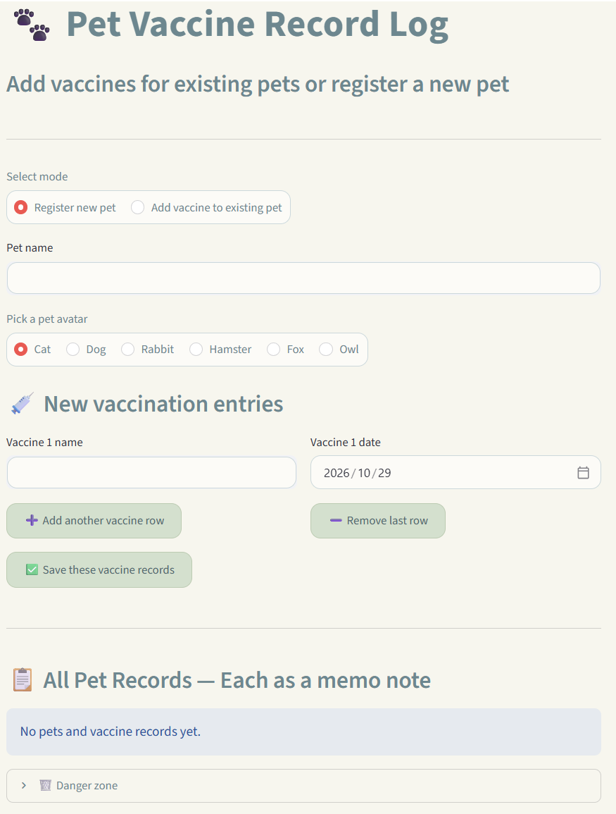

# Pet Vaccine Record Log

A lightweight interactive web tool designed for pet owners to securely log, organise and keep track of their pets’ full vaccination history. It helps users maintain clear records of vaccine details and deadlines



## Live demo

[https://interactive-mapphkjbmjpzpwrbhghvcr9.streamlit.app/](https://interactive-mapphkjbmjpzpwrbhghvcr9.streamlit.app/)

## Intended user

Pet owners looking for a straightforward tool to log vaccination dates and quickly check whether each vaccine is still valid, nearing renewal, or expired.

## Design concept

This design prioritises clean memo-style visual cards for quick scanning. I adopted a casual notepad aesthetic to make vaccination records approachable and easy to understand. The colour-coded status system allows users to instantly spot vaccine entries that require attention.

## Main interaction

Users fill out a form with the pet's name, vaccine name, vaccination date, and select a pixel-style pet avatar. Multiple vaccine entries can be submitted at once. After saving, memo-style cards are generated for the pet.

The app automatically calculates the time since vaccination and shows colour-coded status labels:

- **Valid** — vaccinated within the past 330 days
- **Coming due soon** — vaccinated 331–365 days ago
- **Expired** — vaccinated more than 365 days ago
- **Scheduled** — future date for upcoming appointments

Users can add or delete vaccine rows before submission, export all records as a PNG, or clear all data. A confirmation checkbox prevents accidental deletion.

A warning will pop up and block saving if the pet name or vaccine name is empty, or if the pet name already exists.

## Limitation

Data only stays in the browser memory; all records will be cleared once the page reloads. There is no permanent cloud database for storage.

## How to run

**Option 1: Live demo (no setup required)**

Open the demo link above directly.

**Option 2: Run locally**

This project uses [uv](https://docs.astral.sh/uv/) for dependency management.

```bash
git clone https://github.com/ANSEL-cmd/Interactive.git
cd Interactive
uv run streamlit run app.py